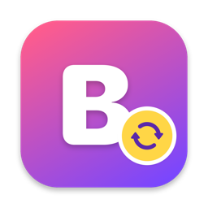
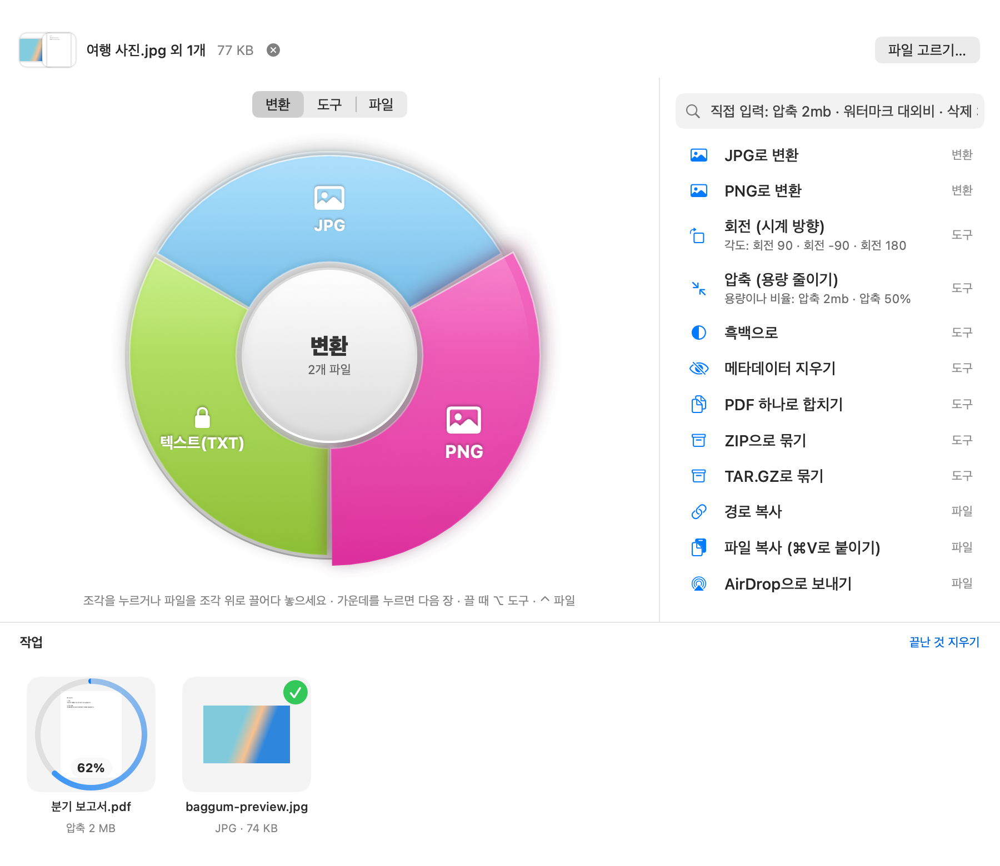

# Baggum — 메뉴바 파일 변환기

메뉴바에 사는 macOS 파일 변환기. 이미지·영상·오디오·PDF·한글(HWP)·문서·자막을 **색깔 휠**에서 고르거나 **단축키**로 바꿉니다. 모든 처리는 내 Mac 안에서만 하고, 결과는 원본 옆에 새 파일로 저장합니다.

**[⬇︎ Baggum 1.0 내려받기 (DMG)](https://github.com/igomumugo/baggum-download/releases/download/v1.0/Baggum-1.0.dmg)** · **[사용법 자세히 보기](https://igomumugo.github.io/baggum-download/)**

macOS 13 이상 · Apple 실리콘·Intel · 무료판으로 시작, 인증키로 Pro

## 설치

1. `Baggum-1.0.dmg`를 열고 Baggum을 Applications 폴더로 끌어다 놓습니다.
2. Baggum을 엽니다. "확인되지 않은 개발자" 창이 뜨면 **시스템 설정 → 개인정보 보호 및 보안 → 그래도 열기** (처음 한 번만).
3. 영상·오디오 변환에는 ffmpeg가 필요합니다: `brew install ffmpeg`

## 쓰는 법

- **창에서 휠**: 파일을 Baggum 창에 끌어다 놓고 휠 조각을 누릅니다 (변환 · 도구 · 파일 휠).
- **Finder에서 Shift-드래그**: Shift를 누른 채 파일을 끌면 커서 옆에 휠이 뜹니다. ⌥ 도구 · ⌃ 파일.
- **단축키**: 파일을 고르고 `⌃⌥Space` → `압축 2mb`처럼 입력 → `↩`. 같은 작업 반복은 `⌃⌥R`.

자세한 사용법, 기능 목록, 무료판과 Pro 비교, 자주 묻는 질문은 [소개 페이지](https://igomumugo.github.io/baggum-download/)에 있습니다.
